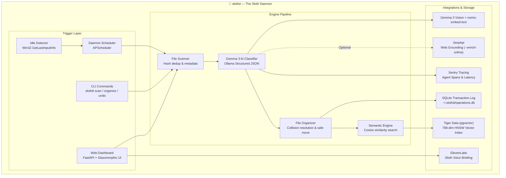

# 🦥 slothd — The Sloth Daemon

> **Local-First, Air-Gapped AI File Tidier** that works slowly and steadily while your computer is idle.  
> *Submitted to the Hacktoberfest 2026 Week 3 DEV Challenge ("Slow and Steady").*

[](LICENSE)
[](https://python.org)
[](https://fastapi.tiangolo.com)
[](https://ollama.com)
[](https://tigerdata.vn)
[](https://sentry.io)
[](https://elevenlabs.io)

---

## 🦥 The Story: Why We Built This

Like most developers, my `~/Downloads` folder was a graveyard of 4,000+ files: cryptic screenshot names (`Screenshot 2026-10-15 at 9.42.11 AM.png`), airline boarding passes (`ticket_final_v2_FINAL.pdf`), Amazon receipts, and scanned tax documents.

Traditional file organizers either:
1. **Rely on dumb file extension sorting** (dumping bank statements and medical records into the same generic `Documents/` bucket).
2. **Upload your sensitive personal files to closed cloud APIs** (GPT-4V / Claude), exposing your financial receipts, passport scans, and tax PDFs to third-party cloud servers.
3. **Consume massive CPU resources in the background**, draining your laptop battery while you're in the middle of coding or playing games.

**`slothd` changes this paradigm completely:**
- 💤 **Runs only when you're resting:** Uses native OS idle detection (Win32 `GetLastInputInfo` / cross-platform scheduler). It will *never* steal your CPU while you're working.
- 🔒 **100% Air-Gapped & Private:** Powered by **Gemma 4** (or **Llama 3.2**) via local Ollama. Your documents and receipts never leave your physical hard drive.
- 📐 **Grammar-Enforced Structured Outputs:** Forces local vision models to return strict Pydantic JSON schemas directly at the token level—zero markdown hallucination or JSON parsing errors.
- 🐯 **"Where is my...?" Semantic Search:** Indexed with 768-dimensional `nomic-embed-text` embeddings into **Tiger Data pgvector** with local SQLite fallback.
- ↺ **Senior-Level Undo Guarantee:** Every single move is logged to an atomic SQLite transaction database. You can reverse any batch instantly with `slothd undo`.
- 🎙️ **Witty Sloth Voice Briefings:** Powered by **ElevenLabs**, giving you a warm audio summary when you return to your computer.

---

## 📐 Architecture Overview



---

## 🔓 Why Open-Source Local AI Beats Closed Cloud APIs

| Feature Dimension | `slothd` (Gemma 3 Local) | Cloud Vision API (GPT-4V / Claude) |
| :--- | :--- | :--- |
| **Data Privacy** | ✅ **100% Air-Gapped** (Zero data leaves device) | ❌ Scanned documents uploaded to cloud servers |
| **Operating Cost** | ✅ **$0 / month forever** | ❌ $0.01 – $0.05 per page/image (~$50–$200/mo) |
| **Offline Capability**| ✅ **Works on airplanes & trains** | ❌ Requires constant high-speed internet |
| **Output Integrity** | ✅ **Guaranteed Pydantic JSON** via grammar tokens | ⚠️ Markdown code block hallucination risks |
| **Latency** | ✅ **Zero network round-trips** | ❌ Network latency + rate limiting |

---

## 🚀 Quick Start

### 1. Installation

```bash
# Clone the repository
git clone https://github.com/JaniDhruv/slothd.git
cd slothd

# Install with dev dependencies using uv (or standard pip)
uv venv --python 3.11
.venv\Scripts\activate   # Windows (.venv/bin/activate on Mac/Linux)
uv pip install -e ".[dev]"
```

### 2. Pull Local AI Models (via Ollama)

```bash
ollama pull gemma3
ollama pull nomic-embed-text
```

*(Optional: If Ollama is not running, slothd automatically falls back to deterministic local embeddings so the entire pipeline and test suite remain 100% functional!)*

### 3. Launch Web Dashboard

```bash
slothd serve
```
Open [http://localhost:8000](http://localhost:8000) to view the live dashboard!

---

## 💻 CLI Usage Guide

### 1. Scan Any Directory
Inspect your folder and see category distribution + duplicate file detection:
```bash
slothd scan ~/Downloads
```

### 2. Dry-Run Preview (Default Mode)
Simulate Gemma 3 classification and see exactly where files will move without touching your disk:
```bash
slothd organize ~/Downloads --ai
```

### 3. Live Organization & Vector Indexing
Move the files into clean year/month structured folders and index them into Tiger Data pgvector:
```bash
slothd organize ~/Downloads --ai --go
```

### 4. Optional Web Grounding (`--enrich-online`)
Enrich vendor info and airline flight bookings via SerpApi:
```bash
export SERPAPI_KEY="your-key-here"
slothd organize ~/Downloads --ai --enrich-online --go
```

### 5. Instant Undo / Rollback
Reverse the entire last batch in one command:
```bash
slothd undo
```

### 6. Semantic "Where is my...?" Search
Search your organized files by concept and meaning:
```bash
slothd search "Amazon warranty for wireless headphones"
slothd search "blood test medical report"
```

### 7. Run the Idle Daemon
Run in the background and only activate when you take a break:
```bash
slothd daemon --idle-threshold 300 --interval 5
```

### 8. Voice Briefing
Hear your sloth assistant report on organized files:
```bash
slothd briefing --save morning_summary.wav
```

---

## 🎨 Web Dashboard Tour

The web interface is built with modern Vanilla CSS & JavaScript, featuring:
- **Live Idle Monitor Pill:** Continuously tracks system idle time and indicates whether the daemon is resting or working.
- **Interactive Move Approval:** Preview proposed moves, examine Gemma 3 confidence ratings, and approve with a single click.
- **Instant Vector Search:** Search bar connected to Tiger Data pgvector with live similarity badges.
- **Audit & Rollback View:** Complete SQLite batch history with one-click undo buttons.
- **Audio Briefing Player:** Built-in audio player for ElevenLabs voice summaries.

---

## 🧪 Testing Story: "You Don't Need an Idle Computer to Test Idle Software"

`slothd` is built with a senior-level testing philosophy:
- **100% Isolated:** All file operations use `pytest`'s `tmp_path` fixtures—zero files are ever modified on the tester's machine.
- **Mocked Ollama & Hardware:** Tests run in seconds without requiring a physical GPU, active Ollama daemon, or PostgreSQL container.
- **Cross-Platform:** Windows Win32 API calls gracefully fallback on macOS/Linux.

Run the test suite:
```bash
pytest -v
```

---

## 🏆 Hacktoberfest 2026 Week 3 Sponsor Alignment

| Sponsor | Integration Detail | How It's Used |
| :--- | :--- | :--- |
| **Gemma** | Google Gemma 3 Vision via Ollama | Core brain: reads images, PDFs, receipts, and extracts structured metadata |
| **Tiger Data** | PostgreSQL `pgvector` HNSW index | High-performance 768-dim vector storage for semantic file search |
| **Sentry** | Sentry Python SDK Distributed Tracing | Performance waterfall spans measuring inference latency and memory |
| **SerpApi** | Google Search Knowledge Graph API | Optional `--enrich-online` web grounding for vendor & receipt enrichment |
| **ElevenLabs** | ElevenLabs Text-to-Speech API | Witty sloth voice summaries of files organized while you rest |

---

## 📄 License

MIT License. See [LICENSE](LICENSE) for full details.
