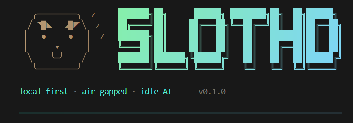
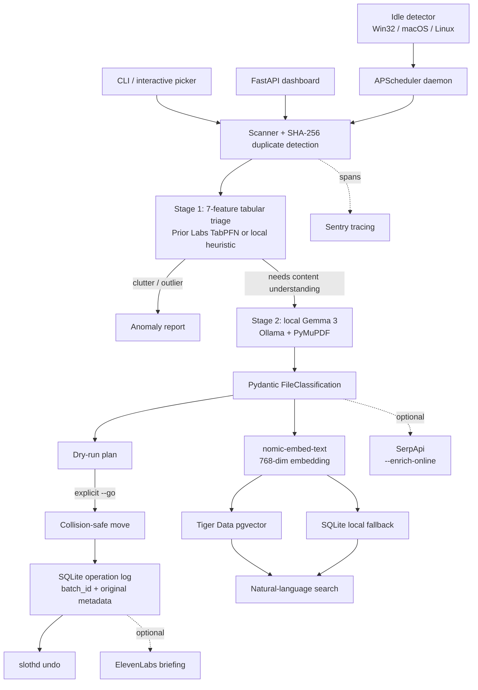
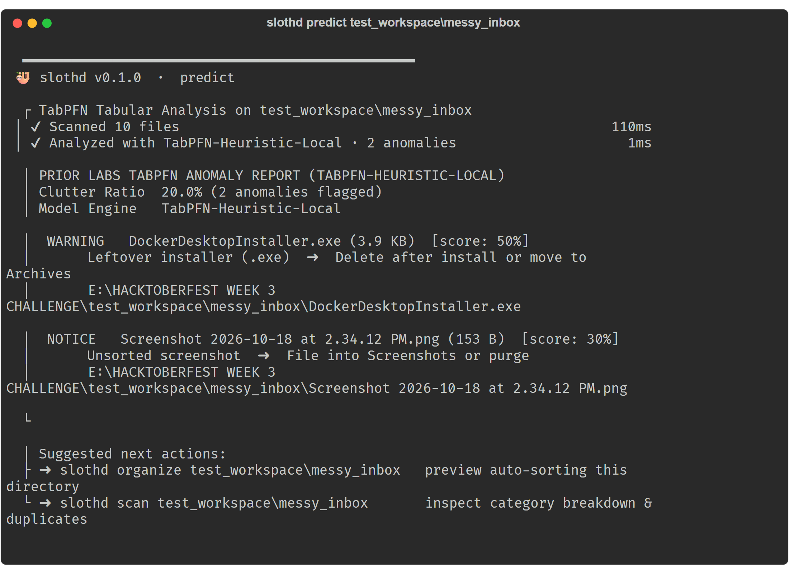
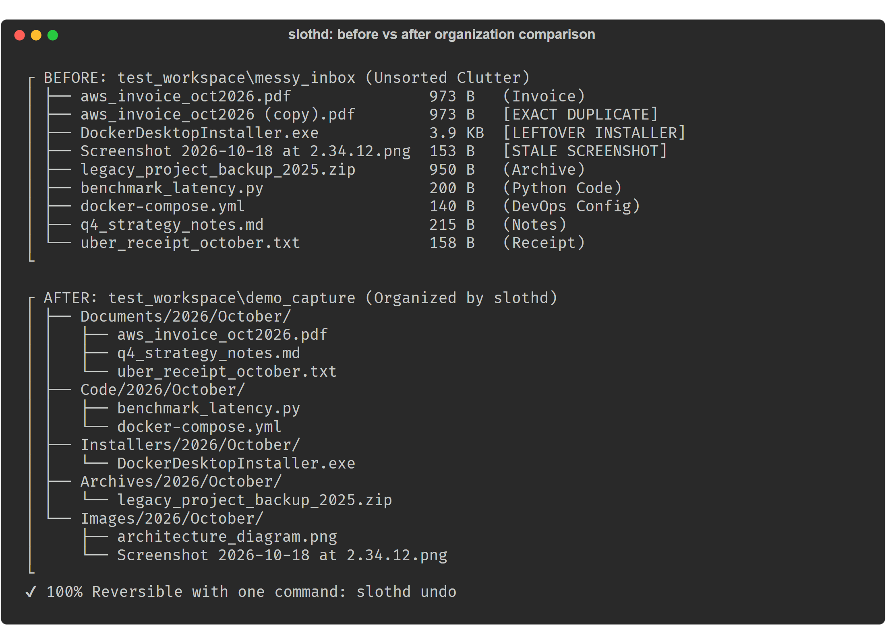
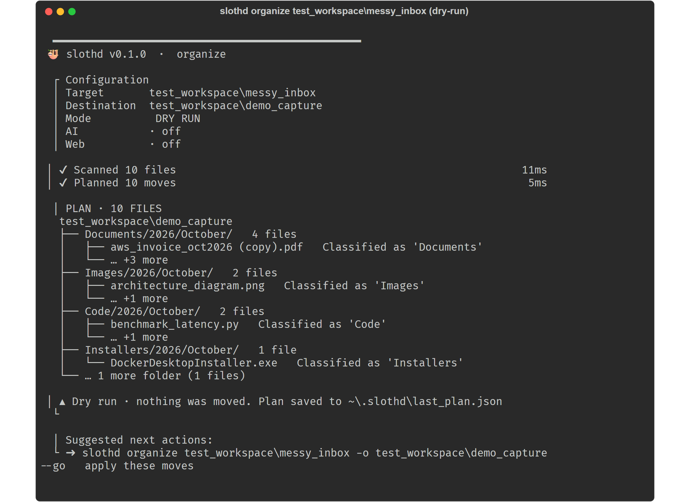
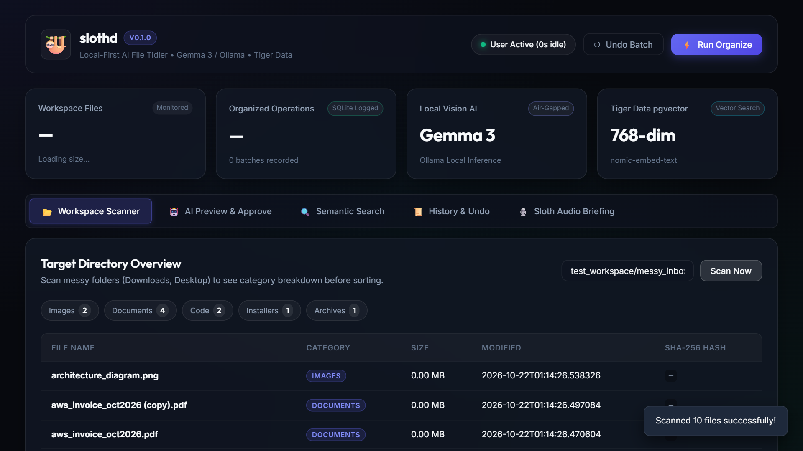

<div align="center">
  

  <p><b>A local-first AI file organizer that waits until your computer is idle, understands what your files mean, and lets you undo every move.</b></p>

  <p align="center">
    <a href="https://github.com/JaniDhruv/slothd/actions/workflows/ci.yml"></a>
    
    <a href="https://www.python.org/"></a>
    <a href="https://ollama.com/"></a>
    <a href="https://priorlabs.ai/"></a>
    <a href="LICENSE"></a>
    <a href="LICENSE"></a>
  </p>

  <p>
    <b>Built for the <a href="https://dev.to/challenges/hacktoberfest-week3-2026-10-19">Hacktoberfest 2026 Week 3 “Slow and Steady” challenge</a>.</b>
  </p>
</div>

---

## 📑 Table of Contents

- [🎯 The One-Minute Pitch](#-the-one-minute-pitch)
  - [😴 The Lazy Payoff](#-the-lazy-payoff)
- [💡 Why This is Different](#-why-this-is-different)
- [🧩 Architecture](#-architecture)
- [🔀 The Two-Stage Funnel](#-the-two-stage-funnel)
- [🧪 Offline Demo Fixture](#-offline-demo-fixture)
- [🚀 Quick Start](#-quick-start)
- [💻 CLI Guide](#-cli-guide)
  - [Quick Reference](#quick-reference)
  - [Detailed Command Reference](#detailed-command-reference)
  - [🛡️ Safety Rules](#️-safety-rules)
- [📊 Dashboard](#-dashboard)
- [🔒 Integrations and Privacy Boundaries](#-integrations-and-privacy-boundaries)
- [🛠️ Developer Experience & AI Tooling](#️-developer-experience--ai-tooling)
- [✅ Verification](#-verification)
- [🏁 Hacktoberfest Week 3 Track Alignment](#-hacktoberfest-week-3-track-alignment)
- [⏱️ 5-Minute Evaluation Walkthrough](#️-5-minute-evaluation-walkthrough)
- [⚠️ Current Limitations](#️-current-limitations)
- [📍 Roadmap](#-roadmap)
- [📄 License](#-license)

---

## 🎯 The one-minute pitch

Downloads folders become unmanageable because file names are poor metadata. `slothd` is a background assistant for fixing that problem without sending private documents to a cloud AI service:

1. It waits for the user to be idle.
2. It scans lightweight filesystem metadata first.
3. Prior Labs TabPFN (or the deterministic local heuristic fallback) spots clutter, stale archives, installers, and outliers.
4. Only files that need content understanding reach local **Gemma 3** through Ollama.
5. It previews the plan before making changes.
6. Every approved move is logged in SQLite and can be reversed with one command.

The result is a patient file assistant that is useful offline, safe around sensitive files, and pleasant to operate.

### ▶ Watch the live walkthrough

<a href="docs/demo/slothd-demo.mp4">
  
</a>

**[▶ Open the full `slothd-demo.mp4` recording](docs/demo/slothd-demo.mp4)** ([WebM format](docs/demo/slothd-demo.webm)) — scan a messy folder, preview an organization plan, approve moves, search the index, inspect history, and undo the batch.

### 😴 The lazy payoff

Instead of manually opening, renaming, deduplicating, and filing every download, the user gets:

- a quick anomaly report before expensive classification
- a proposed organization plan instead of a blank folder
- a searchable index for “where is my …?” questions
- a voice summary when the work is finished
- one-command rollback when the result is not right

The included fixture demonstrates the measurable loop: **10 files scanned, 2 clutter anomalies identified, 1 duplicate set found, and 973 B reclaimable**—without requiring an active AI server.

## 💡 Why this is different

| Problem | slothd’s answer |
| --- | --- |
| A background organizer can interrupt active work | Cross-platform idle detection and an APScheduler daemon |
| Extension sorting cannot distinguish an invoice from a receipt | Two-stage metadata triage followed by local Gemma 3 classification |
| Cloud AI is a poor default for tax, health, and financial documents | Local Ollama inference; online enrichment is an explicit opt-in |
| Automated moves are hard to trust | Dry-run by default, collision-safe paths, SQLite operation log, and `slothd undo` |
| AI responses are difficult to validate | Ollama receives the Pydantic `FileClassification` JSON schema |
| Offline environments and missing dependencies | Deterministic heuristic fallbacks, offline vector index, isolated test suite, and cross-platform CI |

## 🧩 Architecture



More implementation detail is in [`docs/architecture.md`](docs/architecture.md).

## 🔀 The two-stage funnel

### Stage 1 — fast, cheap metadata triage

`slothd predict DIRECTORY` extracts seven features from each file:

1. log-scaled size
2. extension group
3. relative path depth
4. hour of modification
5. day of week
6. filename length
7. digit/UUID signal

TabPFN support is optional. Without the TabPFN package or credentials, `slothd` automatically operates using its local deterministic heuristic engine (`TabPFN-Heuristic-Local`) while preserving the exact same seven-feature interface and anomaly report.

### Stage 2 — only when semantics are needed

Documents that need content comprehension can be classified by local Gemma 3 via Ollama. PDFs are handled with PyMuPDF, and the classifier is constrained with a Pydantic schema containing category, subcategory, description, date, vendor, proposed name, confidence, and tags.

If Ollama is unreachable, `slothd` performs a fast connectivity check and immediately falls back to local classification instead of hanging the CLI.

## 🧪 Offline demo fixture

The repository includes a reproducible fixture in [`test_workspace/messy_inbox`](test_workspace/messy_inbox) containing invoices, code, an installer, an archive, a screenshot, and a deliberate duplicate:

```powershell
uv run slothd predict test_workspace\messy_inbox
```

Representative output:

```text
✔ Scanned 10 files
✔ Analyzed with TabPFN-Heuristic-Local · 2 anomalies · 1ms

Clutter Ratio  20.0% (2 anomalies flagged)
WARNING        DockerDesktopInstaller.exe  · leftover installer
NOTICE         Screenshot ...png            · unsorted screenshot
```

Inspect duplicates and categories:

```powershell
uv run slothd scan test_workspace\messy_inbox
```

```text
✔ Scanned 10 files · 8.0 KB
▲ 1 duplicate set · 973 B reclaimable
```



*The included fixture is intentionally small and offline-friendly: metadata triage flags the leftover installer and unsorted screenshot before heavier classification is needed.*

Preview, apply, and undo organization:

```powershell
# Preview organization plan (dry-run by default)
uv run slothd organize test_workspace\messy_inbox --output test_workspace\demo_out

# Apply moves with WAL-backed SQLite operation logging
uv run slothd organize test_workspace\messy_inbox --output test_workspace\demo_out --go

# Instant rollback of all moves from that batch
uv run slothd undo
```

```text
  ┌ Undoing batch batch_7a89f10b
  ✔ Restored 10/10 files from batch batch_7a89f10b
```



*The same fixture goes from a flat inbox to dated category folders, with the move batch recorded for rollback.*

## 🚀 Quick start

### Requirements

- Python 3.10+
- [`uv`](https://docs.astral.sh/uv/)
- Windows, macOS, or Linux
- Ollama is optional for local Gemma 3 classification

### Install

```powershell
git clone https://github.com/JaniDhruv/slothd.git
cd slothd
uv venv --python 3.11
.venv\Scripts\activate
uv pip install -e ".[dev]"
```

For macOS/Linux, activate the environment with `.venv/bin/activate`.

### Optional local AI

```powershell
ollama pull gemma3
ollama pull nomic-embed-text
```

Copy [`.env.example`](.env.example) to `.env` only when you want to configure local models, Tiger Data, Sentry, SerpApi, or ElevenLabs. Basic scanning, prediction, dry runs, tests, and offline fallbacks do not need those services.

## 💻 CLI guide

### Quick reference

| Goal | Command | Safety |
| --- | --- | --- |
| Interactive picker | `slothd` | Guides source, destination, and next actions |
| Scan files and duplicates | `slothd scan DIRECTORY` | Read-only |
| Find clutter and outliers | `slothd predict DIRECTORY` | Read-only |
| Preview organization | `slothd organize DIRECTORY --ai` | Dry-run by default |
| Apply an approved plan | `slothd organize DIRECTORY --ai --go` | Logs every move |
| Choose an output root | `slothd organize DIRECTORY -o ORGANIZED` | Collision-safe |
| Reverse the last batch | `slothd undo` | Restores logged moves |
| Search by meaning | `slothd search "AWS invoice"` | Uses Tiger Data or SQLite fallback |
| Run while away | `slothd daemon --idle-threshold 300 --interval 5` | Activates only after idle threshold |
| Start dashboard | `slothd serve` | Binds to localhost by default |
| Generate briefing | `slothd briefing --save docs/sloth_briefing.wav` | ElevenLabs optional; local audio fallback |
| Inspect Copilot setup | `slothd copilot` | Read-only |

### Detailed command reference

#### 1. Interactive picker (recommended)
Launch the interactive command loop with arrow-key navigation and suggested next actions:
```bash
slothd
```
Select source folders (Downloads, Desktop, Documents, or Custom) and destinations without hardcoded paths.

#### 2. Prior Labs TabPFN clutter triage (`slothd predict`)
Extract 7 tabular metadata features and flag clutter, leftover installers, and stale archives in milliseconds:
```bash
slothd predict ~/Downloads
```

#### 3. Duplicate and category scanner (`slothd scan`)
Inspect file category distributions and calculate reclaimable disk space across SHA-256 duplicate clusters:
```bash
slothd scan ~/Downloads
```

#### 4. Dry-run preview (default)
Classify files using local Gemma 3 via Ollama and preview proposed destinations without modifying any file:
```bash
slothd organize ~/Downloads --ai
```

#### 5. Apply file organization (`--go`)
Execute the moves with collision-safe naming (`_1`, `_2`), WAL-backed SQLite operation logging, and rollback tracking:
```bash
slothd organize ~/Downloads --ai --go
```

#### 6. Optional web grounding (`--enrich-online`)
Enrich unknown invoice vendors or warranty documents via SerpApi Google Knowledge Graph search:
```bash
slothd organize ~/Downloads --ai --enrich-online --go
```

#### 7. Instant rollback (`slothd undo`)
Restore all files from the last execution batch back to their exact original locations:
```bash
slothd undo
```

#### 8. Semantic search (`slothd search`)
Query your files in natural language using Tiger Data pgvector embeddings (or local SQLite fallback):
```bash
slothd search "AWS cloud hosting invoice"
slothd search "blood test lab report"
```

#### 9. Idle daemon mode (`slothd daemon`)
Run silently in the background, executing organization cycles only when your computer is idle:
```bash
# Fast metadata-based sorting
slothd daemon --idle-threshold 300 --interval 5

# With local Gemma 3 semantic classification
slothd daemon --idle-threshold 300 --interval 5 --use-ai
```

#### 10. Voice briefing (`slothd briefing`)
Generate a sloth-themed audio summary of organized files via ElevenLabs (or synthetic audio fallback):
```bash
slothd briefing --save docs/sloth_briefing.wav
```

#### 11. GitHub Copilot inspection (`slothd copilot`)
Inspect the active Copilot instruction set, prompt library (`/audit-privacy`, `/new-sorter`, `/tabpfn-feature`), and air-gap rules directly in your terminal:
```bash
slothd copilot
```



*The default path is deliberately non-destructive: the plan is visible and saved, but no file is moved until `--go` is supplied.*

### 🛡️ Safety rules

> [!IMPORTANT]
> - `organize` is a preview unless `--go` is supplied.
> - No file is overwritten: collisions become `_1`, `_2`, and so on.
> - Moves are grouped by a unique batch ID in the SQLite operation log.
> - File metadata is preserved where the underlying filesystem move supports it; original move details and paths are logged for rollback.
> - `--enrich-online` is the only route to SerpApi web grounding.
> - Missing Ollama, PostgreSQL, or API keys produce explicit local fallbacks.

## 📊 Dashboard

Run:

```powershell
slothd serve
```

Open [http://localhost:8000](http://localhost:8000). The dashboard surfaces:

- idle/working status
- proposed moves and confidence
- semantic search
- operation history and rollback
- audio briefing playback

The web UI is deliberately dependency-light: FastAPI routes in [`slothd/web/app.py`](slothd/web/app.py) plus vanilla HTML, CSS, and JavaScript in [`slothd/web/static/index.html`](slothd/web/static/index.html), [`slothd/web/static/style.css`](slothd/web/static/style.css), and [`slothd/web/static/app.js`](slothd/web/static/app.js).



The complete captured walkthrough is available as an animated demonstration in [`slothd-demo.gif`](docs/demo/slothd-demo.gif) and universal MP4 video in [`slothd-demo.mp4`](docs/demo/slothd-demo.mp4) ([WebM format](docs/demo/slothd-demo.webm)). Additional command captures, including the live batch and rollback views, are collected in [`docs/demo/`](docs/demo/).

## 🔒 Integrations and privacy boundaries

| Integration | What it adds | Default |
| --- | --- | --- |
| Ollama + Gemma 3 | Local document and image classification | Off until Ollama is installed/selected |
| Prior Labs TabPFN | Tabular prediction engine | Optional; local heuristic fallback |
| Tiger Data + pgvector | Persistent 768-dimensional semantic index | Optional; SQLite fallback |
| SerpApi | Vendor/entity grounding | **Opt-in only** with `--enrich-online` |
| ElevenLabs | Voice briefing generation | **Opt-in only** with `slothd briefing` |
| Sentry | Pipeline performance spans | Optional DSN |
| Entire.io | Git-native agent/session provenance | Repository development tooling |

> [!NOTE]
> The privacy promise is precise: **the default classification and organization path is local-first and air-gapped**. The two network integrations (SerpApi and ElevenLabs) are separately gated and never silently enabled.
>
> Tiger Data uses `nomic-embed-text` embeddings when available. The SQLite fallback remains fully local and searchable offline, using deterministic embeddings when Ollama is unavailable.

## 🔭 Observability: Sentry as a debugging loop

Sentry is not only a dashboard badge in `slothd`; it helped turn real failure signals into targeted fixes. The application initializes Sentry with release `slothd@0.1.0`, captures exceptions from the classifier, and traces the important pipeline boundaries:

| Signal | What it revealed | Resolution |
| --- | --- | --- |
| Ollama `ConnectionError` on `127.0.0.1:11434` | The classifier needed to fail fast when a local model server was unavailable | [`3a327ea`](https://github.com/JaniDhruv/slothd/commit/3a327ea) added a short reachability probe, local fallback, and a circuit-breaker test |
| Pydantic confidence errors for model outputs such as `90` and `100` | Model confidence sometimes arrived as a percentage instead of the required `0.0–1.0` value | [`a914b53`](https://github.com/JaniDhruv/slothd/commit/a914b53) normalized percentage outputs and added bounds coverage |
| `RuntimeError: generator didn't stop after throw()` | The tracing context manager was swallowing/re-entering exceptions incorrectly | [`df19f29`](https://github.com/JaniDhruv/slothd/commit/df19f29) let exceptions propagate cleanly and added a regression test |

The visible Ollama event in the Sentry project was a **handled test-path failure**, not an unresolved production outage: its event context shows `pytest`, `test_classify_batch_circuit_breaker`, and the offline fallback breadcrumb. That is useful evidence that the failure mode is observable and the fallback path is exercised. The `/sentry-debug` endpoint is intentionally synthetic and exists only to verify Sentry connectivity; it is not a product failure.

Traced operations include `scanner.scan_directory`, `ai.classify`, `ai.classify_batch`, `organizer.preview`, `organizer.execute`, `organizer.undo`, and `search.query`. This gives maintainers both exception context and a transaction-shaped view of the work users care about.

## 🛠️ Developer experience & AI tooling

- [`.github/copilot-instructions.md`](.github/copilot-instructions.md) encodes the project’s privacy, reversibility, model-presentation, TabPFN, and UI rules.
- [`.github/prompts/new-sorter.prompt.md`](.github/prompts/new-sorter.prompt.md) helps add collision-safe category rules.
- [`.github/prompts/audit-privacy.prompt.md`](.github/prompts/audit-privacy.prompt.md) checks for network leaks and un-gated calls.
- [`.github/prompts/tabpfn-feature.prompt.md`](.github/prompts/tabpfn-feature.prompt.md) guides new filesystem metadata features.
- `slothd copilot` exposes those instructions and templates from the terminal.
- [`.github/pull_request_template.md`](.github/pull_request_template.md) keeps privacy, reversibility, tracing, and tests in review.
- [`.github/workflows/ci.yml`](.github/workflows/ci.yml) runs lint plus the test matrix on Ubuntu and Windows with Python 3.11 and 3.12.
- Entire hooks and settings live in [`.agents/hooks.json`](.agents/hooks.json) and [`.entire/settings.json`](.entire/settings.json).

## ✅ Verification

The test suite uses `tmp_path`, mocks external services, and does not require Ollama, PostgreSQL, a GPU, or internet access:

```powershell
uv run pytest tests/ -v -k "not test_idle"
```

Verified locally on 2026-10-21:

```text
107 passed, 11 deselected
```

Lint:

```powershell
uv run ruff check .
```

```text
All checks passed!
```

The deselected tests exercise real OS idle behavior and are intentionally excluded from the deterministic offline command.

## 🏁 Hacktoberfest Week 3 track alignment

Project capabilities mapped to challenge tracks and repository implementations:

| Challenge-facing strength | Evidence in the repository |
| --- | --- |
| Slow and steady background behavior | Cross-platform idle detector and scheduler in [`slothd/daemon`](slothd/daemon) |
| Useful local AI | Gemma 3/Ollama classifier with structured output in [`slothd/engine/classifier.py`](slothd/engine/classifier.py) |
| Tabular AI with a concrete job | Seven-feature clutter triage in [`slothd/engine/tabular_predictor.py`](slothd/engine/tabular_predictor.py) |
| Privacy and trust | Dry-run default, opt-in networking, SQLite rollback, and offline tests |
| Searchable results | Tiger Data pgvector integration plus SQLite fallback in [`slothd/integrations/tiger_data.py`](slothd/integrations/tiger_data.py) |
| Web grounding (opt-in) | SerpApi entity search in [`slothd/integrations/serpapi_client.py`](slothd/integrations/serpapi_client.py), enabled only with `--enrich-online` |
| Observable behavior | Sentry spans in [`slothd/integrations/sentry_tracing.py`](slothd/integrations/sentry_tracing.py) |
| Memorable user experience | Sloth-themed Rich UI, interactive next actions, and voice briefings |
| Strong developer story | Copilot prompt library, PR checklist, `slothd copilot`, CI, and Entire provenance |

## ⏱️ 5-Minute evaluation walkthrough

```text
1. Inspect the messy inbox fixture: `slothd predict test_workspace\messy_inbox`
2. Run duplicate and category scan: `slothd scan test_workspace\messy_inbox`
3. Preview organization without modifying files: `slothd organize test_workspace\messy_inbox`
4. Apply moves safely with rollback logging: `slothd organize test_workspace\messy_inbox --go`
5. Undo all applied moves in one step: `slothd undo`
6. Launch dashboard: `slothd serve`
7. Run automated test suite: `pytest -v -k "not test_idle"`
```

## ⚠️ Current limitations

- **TabPFN**: Optional; automatically falls back to local deterministic heuristics (`TabPFN-Heuristic-Local`) when unconfigured or uninstalled.
- **Gemma 3**: Requires a local Ollama daemon and pulled model weights (`ollama pull gemma3`); falls back to local heuristic routing if Ollama is unreachable.
- **Tiger Data**: Requires a reachable PostgreSQL instance with `pgvector`; SQLite local vector index serves as the zero-config offline fallback.
- **Demo Fixture**: The included `test_workspace/messy_inbox` fixture is intentionally compact for fast, reproducible testing rather than a large multi-gigabyte benchmark.
- **Idle Detection**: Uses OS-specific APIs (Win32 `GetLastInputInfo` / macOS `IOKit` / Linux `xprintidle`); automated tests use simulated idle states to remain deterministic.

## 📍 Roadmap

- Calibrate TabPFN predictions against a larger opt-in local corpus.
- Add more OS-specific idle detection coverage and integration tests.
- Add richer dashboard filtering for operation batches and anomaly reasons.
- Publish a short benchmark comparing metadata triage with full document classification.

## 📄 License

MIT. See [`LICENSE`](LICENSE).
