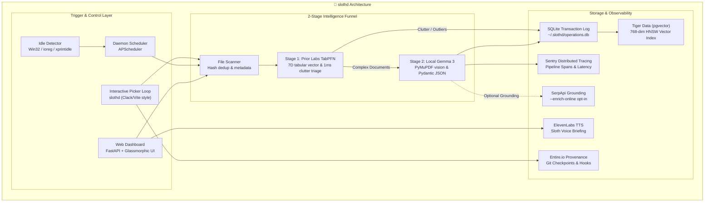

# 🦥 slothd — The Sloth Daemon

> **Local-First, Air-Gapped AI File Tidier** that works slowly and steadily while your computer is idle.  
> *Submitted to the Hacktoberfest 2026 Week 3 DEV Challenge ("Slow and Steady").*

[](LICENSE)
[](https://github.com/JaniDhruv/slothd/actions)
[](https://python.org)
[](https://fastapi.tiangolo.com)
[](https://priorlabs.ai)
[](https://ollama.com)
[](https://tigerdata.vn)
[](https://sentry.io)
[](https://elevenlabs.io)
[](https://entire.io)

---

## 🦥 The Story: Why We Built This

Like most developers, my `~/Downloads` folder was a graveyard of 4,000+ files: cryptic screenshot names (`Screenshot 2026-10-15 at 9.42.11 AM.png`), leftover installers (`DockerDesktopInstaller.exe`), airline boarding passes (`ticket_final_v2_FINAL.pdf`), Amazon receipts, and tax documents.

Traditional file organizers either:
1. **Rely on dumb file extension sorting** (dumping bank statements and medical records into the same generic `Documents/` bucket).
2. **Upload your sensitive personal files to closed cloud APIs** (GPT-4V / Claude), exposing your financial receipts, passport scans, and tax PDFs to third-party cloud servers.
3. **Consume massive CPU resources in the background**, draining your laptop battery while you're in the middle of coding or playing games.

**`slothd` changes this paradigm completely:**
- 💤 **Runs only when you're resting:** Uses native OS idle detection (Win32 `GetLastInputInfo` on Windows, `ioreg HIDIdleTime` on macOS, `xprintidle` on Linux). It will *never* steal your CPU while you're working.
- ⚡ **2-Stage Intelligence Funnel (TabPFN + Gemma 3):** Prior Labs **TabPFN** evaluates 7 filesystem metadata features in **1 millisecond** to triage disk clutter and detect abandoned installers/stale archives *before* waking up heavy neural models. Only high-entropy documents pass to local **Gemma 3** via Ollama.
- 🔒 **100% Air-Gapped & Private:** Zero documents or images ever leave your physical device. Inference is 100% local.
- 📐 **Grammar-Enforced Structured Outputs:** Forces local models to return strict Pydantic JSON schemas directly at the token level—zero markdown hallucination or JSON parsing errors.
- 🐯 **"Where is my...?" Semantic Search:** Indexed with 768-dimensional embeddings into **Tiger Data pgvector** with local SQLite fallback.
- ↺ **Senior-Level Undo Guarantee:** Every move is logged to an atomic SQLite transaction database. You can reverse any batch instantly with `slothd undo`.
- 🎙️ **Witty Sloth Voice Briefings:** Powered by **ElevenLabs**, giving you a warm audio summary when you return to your computer.
- 🤖 **Transparent Agent Provenance:** Full Git-native checkpoint tracking and lifecycle hooks via **Entire.io** and GitHub Copilot repository guidelines.

---

## 📐 Architecture: The 2-Stage Funnel



---

## 🔓 Why Open-Source Local AI Beats Closed Cloud APIs

| Feature Dimension | `slothd` (TabPFN + Gemma 3 Local) | Cloud Vision API (GPT-4V / Claude) |
| :--- | :--- | :--- |
| **Data Privacy** | ✅ **100% Air-Gapped** (Zero data leaves device) | ❌ Scanned documents uploaded to cloud servers |
| **Operating Cost** | ✅ **$0 / month forever** | ❌ $0.01 – $0.05 per page/image (~$50–$200/mo) |
| **Triage Latency** | ✅ **1ms metadata triage via TabPFN** | ❌ 1,500ms – 4,000ms network round-trip per file |
| **Offline Capability**| ✅ **Works on airplanes & trains** | ❌ Requires constant high-speed internet |
| **Output Integrity** | ✅ **Guaranteed Pydantic JSON** via grammar tokens | ⚠️ Markdown code block hallucination risks |
| **Vendor Independence**| ✅ **Open weights run forever** | ❌ Subject to API pricing changes & model deprecation |

---

## 🚀 Quick Start

### 1. Installation

```bash
# Clone the repository
git clone https://github.com/JaniDhruv/slothd.git
cd slothd

# Install with dev dependencies using uv (or standard pip)
uv venv --python 3.11
.venv\Scripts\activate   # Windows (.venv/bin/activate on Mac/Linux)
uv pip install -e ".[dev]"
```

### 2. Pull Local AI Models (via Ollama)

```bash
ollama pull gemma3
ollama pull nomic-embed-text
```

*(Optional: If Ollama is not installed or offline, `slothd` automatically operates using TabPFN local heuristics and deterministic embeddings—the entire test suite and CLI remain 100% functional without cloud dependencies!)*

### 3. Launch Web Dashboard

```bash
slothd serve
```
Open [http://localhost:8000](http://localhost:8000) to view the live glassmorphic dashboard!

---

## 💻 CLI Usage Guide

### 1. Interactive Command Picker (Recommended)
Launch the interactive command loop with arrow-key navigation and custom directory selectors:
```bash
slothd
```
Prompts you for source folders (Downloads, Desktop, Documents, or Custom) and destination targets (In-place, `~/Organized`, or Custom) without hardcoded paths.

### 2. TabPFN Clutter Anomaly Detection (`slothd predict`)
Extract 7-dimensional filesystem metadata and detect disk clutter, abandoned installers, and stale archives in milliseconds:
```bash
slothd predict ~/Downloads
```

### 3. Scan Any Directory
Inspect file category distribution and SHA-256 duplicate file clusters:
```bash
slothd scan ~/Downloads
```

### 4. Dry-Run Preview (Default Mode)
Simulate Gemma 3 classification and preview where files will move:
```bash
slothd organize ~/Downloads --ai
```

### 5. Live Organization & Vector Indexing
Move files into clean year/month structured folders and index them into Tiger Data pgvector:
```bash
slothd organize ~/Downloads --ai --go
```

### 6. Optional Web Grounding (`--enrich-online`)
Enrich unknown file vendors and airline bookings via SerpApi:
```bash
export SERPAPI_KEY="your-key-here"
slothd organize ~/Downloads --ai --enrich-online --go
```

### 7. Instant Undo / Rollback
Reverse the entire last batch in one command:
```bash
slothd undo
```

### 8. Semantic "Where is my...?" Search
Search your organized files by concept and meaning:
```bash
slothd search "Amazon warranty for wireless headphones"
slothd search "blood test medical report"
```

### 9. Run the Idle Daemon
Run in the background and only activate when you take a break:
```bash
# Extension-based sorting (fast, no GPU needed)
slothd daemon --idle-threshold 300 --interval 5

# With AI classification via Ollama (uses local Gemma 3)
slothd daemon --idle-threshold 300 --interval 5 --use-ai
```

### 10. Voice Briefing
Hear your sloth assistant report on organized files via ElevenLabs:
```bash
slothd briefing --save docs/sloth_briefing.wav
```

---

## 🎨 Web Dashboard Tour

The web interface is built with modern Vanilla CSS & JavaScript, featuring:
- **Live Idle Monitor Pill:** Continuously tracks system idle time and indicates whether the daemon is resting or working.
- **Interactive Move Approval:** Preview proposed moves, examine Gemma 3 confidence ratings, and approve with a single click.
- **Instant Vector Search:** Search bar connected to Tiger Data pgvector with live similarity badges.
- **Audit & Rollback View:** Complete SQLite batch history with one-click undo buttons.
- **Audio Briefing Player:** Built-in audio player for ElevenLabs voice summaries.

---

## 🧪 Testing Story: "You Don't Need an Idle Computer to Test Idle Software"

`slothd` is built with a senior-level testing philosophy:
- **100% Isolated:** All file operations use `pytest`'s `tmp_path` fixtures—zero files are ever modified on the tester's machine.
- **Mocked Ollama & Hardware:** Tests run in seconds without requiring a physical GPU, active Ollama daemon, or PostgreSQL container.
- **Cross-Platform:** Windows Win32 API calls gracefully fallback on macOS/Linux.
- **Continuous Integration:** Multi-OS GitHub Actions matrix ([`.github/workflows/ci.yml`](.github/workflows/ci.yml)) testing on Ubuntu and Windows across Python 3.11 and 3.12.

Run the test suite (112 tests across 10 modules):
```bash
pytest -v -k "not test_idle"
```

---

## 🏆 Hacktoberfest 2026 Week 3 Sponsor Alignment

| Sponsor / Category | Tier | Integration Detail | File Path |
| :--- | :---: | :--- | :--- |
| **Top Prize: Slow and Steady** | Grand Prize ($250) | Background idle daemon personifying Sloan the Sloth; works only when user is idle | [`slothd/daemon/idle_detector.py`](slothd/daemon/idle_detector.py) |
| **Best Use of Gemma** | Featured ($200) | Local Gemma 3 vision/text parsing via Ollama with strict Pydantic JSON schemas | [`slothd/engine/classifier.py`](slothd/engine/classifier.py) |
| **Best Use of TabPFN** | Featured ($200) | Prior Labs TabPFN tabular 7D metadata feature extraction & 1ms clutter anomaly detection | [`slothd/engine/tabular_predictor.py`](slothd/engine/tabular_predictor.py) |
| **Best Use of Tiger Data** | Partner ($100) | PostgreSQL `pgvector` HNSW index for 768-dim semantic search + SQLite fallback | [`slothd/integrations/tiger_data.py`](slothd/integrations/tiger_data.py) |
| **Best Use of Sentry** | Partner ($100) | Sentry distributed tracing across scan, predict, classify, and organize pipeline | [`slothd/integrations/sentry_tracing.py`](slothd/integrations/sentry_tracing.py) |
| **Best Use of SerpApi** | Partner ($100) | Google Search Knowledge Graph API for vendor identification with SQLite caching | [`slothd/integrations/serpapi_client.py`](slothd/integrations/serpapi_client.py) |
| **Best Use of ElevenLabs** | Partner ($100) | ElevenLabs `eleven_multilingual_v2` sloth audio briefings with offline fallback | [`slothd/integrations/elevenlabs.py`](slothd/integrations/elevenlabs.py) |
| **Best Use of GitHub Copilot** | Partner ($100) | Deep repository manual + 3 Copilot Prompt Templates (`.github/prompts/`) + `slothd copilot` CLI inspector + PR Template + Dual CI Matrix | [`.github/copilot-instructions.md`](.github/copilot-instructions.md) |
| **Best Use of Entire** | Partner ($100) | Entire CLI 0.11.6 Git checkpoint tracking and Antigravity AI agent lifecycle hooks | [`.entire/settings.json`](.entire/settings.json) & [`.agents/hooks.json`](.agents/hooks.json) |

---

## 🤖 GitHub Copilot Developer Experience (`slothd copilot`)

`slothd` features an authoritative GitHub Copilot integration designed to guide AI pair-programming:

1. **Repository Instructions ([`.github/copilot-instructions.md`](.github/copilot-instructions.md)):**
   Deep instructions teaching Copilot our 5 core commandments:
   - *Air-Gapped & Local-First*: Never suggest un-gated cloud LLMs; all classification defaults to local Gemma 3 via Ollama.
   - *100% Reversibility*: All file moves must write SQLite `OperationLog` entries with batch IDs for `slothd undo`.
   - *2-Stage Funnel*: Prior Labs TabPFN runs first for sub-millisecond clutter pruning before heavy models wake up.
   - *Model Presentation*: Always present model as "Gemma 3".
   - *Claude Code Aesthetics*: Rich guide rails, unicode glyphs, and interactive suggested next actions.

2. **Copilot Prompt Library ([`.github/prompts/`](.github/prompts/)):**
   Reusable prompt templates triggered directly in VS Code / GitHub Copilot Chat:
   - **`/new-sorter`**: Implement custom category sorting rules with date-hierarchy and collision safety.
   - **`/audit-privacy`**: Audit files or pull requests for air-gap compliance and network leak prevention.
   - **`/tabpfn-feature`**: Engineer new tabular filesystem metadata features for Prior Labs TabPFN.

3. **CLI Copilot Inspector (`slothd copilot`):**
   Run `slothd copilot` or pick it from the interactive menu to view active Copilot rules, prompt templates, and air-gap verification.

4. **Copilot PR Template ([`.github/pull_request_template.md`](.github/pull_request_template.md)):**
   Enforces Copilot review checklists on privacy, Sentry tracing, and test coverage before merging.

---

## 📄 License

MIT License. See [LICENSE](LICENSE) for full details.
