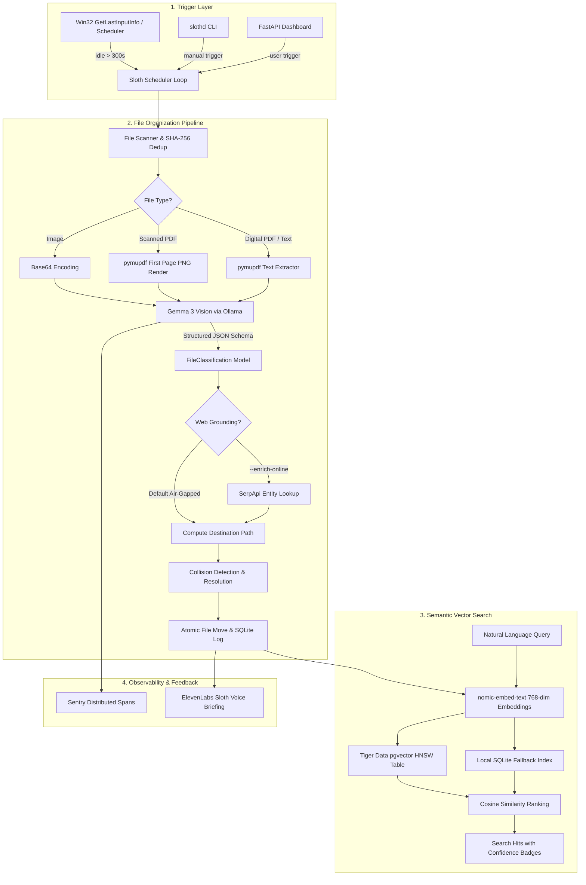

# 🦥 slothd Architecture & Engineering Deep Dive

## 1. System Design Philosophy

`slothd` is engineered around three non-negotiable architectural tenets:
1. **Zero Resource Theft:** Background daemons that degrade foreground interactive tasks are hostile to users. `slothd` only runs when the user has stepped away from their computer.
2. **Air-Gapped Confidentiality:** Personal folders contain tax filings, mortgage contracts, health test receipts, and personal photos. Sending these to third-party cloud LLMs violates user privacy. `slothd` performs 100% of reasoning on-device using Google's **Gemma 3 Vision**.
3. **Deterministic Safety & Reversibility:** AI file organization is inherently non-deterministic. Without atomic transaction logging and one-command rollback (`slothd undo`), users will never trust an automated system.

---

## 2. High-Level Architecture



---

## 3. The Structured Output Pipeline

Most LLM integrations suffer from flaky JSON output, markdown code block fences (` ```json `), or hallucinated keys. In `slothd`, we pass the exact Pydantic JSON schema to Ollama's `format` parameter:

```python
class FileClassification(BaseModel):
    category: str = Field(description="High-level category")
    subcategory: str = Field(description="Specific subcategory")
    description: str = Field(description="1-sentence summary")
    date: str | None = Field(default=None, description="Extracted date in YYYY-MM-DD")
    vendor: str | None = Field(default=None, description="Company or merchant name")
    proposed_name: str = Field(description="Normalized Category_Vendor_Date_Description")
    confidence: float = Field(ge=0.0, le=1.0)
    tags: list[str] = Field(default_factory=list)


schema = FileClassification.model_json_schema()
response = client.chat(
    model="gemma3",
    messages=[{"role": "user", "content": VISION_PROMPT, "images": [img_b64]}],
    format=schema,  # Constrains grammar at decoding time
)
```

This ensures that the output is 100% valid JSON conforming to the schema directly from the token sampler, eliminating retry loops and JSON decode errors.

---

## 4. Tiger Data pgvector Storage

When Tiger Data PostgreSQL is enabled, file embeddings are indexed into a dedicated vector table:

```sql
CREATE EXTENSION IF NOT EXISTS vector;

CREATE TABLE IF NOT EXISTS file_embeddings (
    id          SERIAL PRIMARY KEY,
    file_path   TEXT UNIQUE NOT NULL,
    file_name   TEXT NOT NULL,
    category    TEXT NOT NULL,
    subcategory TEXT,
    description TEXT,
    vendor      TEXT,
    file_date   TEXT,
    tags        TEXT[],
    embedding   vector(768),
    indexed_at  TIMESTAMPTZ DEFAULT NOW()
);

CREATE INDEX IF NOT EXISTS file_embeddings_vec_idx
ON file_embeddings
USING hnsw (embedding vector_cosine_ops);
```

Queries calculate cosine similarity with high efficiency using the `<=>` distance operator:

```sql
SELECT
    file_path, file_name, category, description, vendor,
    1 - (embedding <=> %s) AS similarity
FROM file_embeddings
ORDER BY embedding <=> %s ASC
LIMIT 5;
```

---

## 5. Offline Fallback Architecture

To ensure zero dependencies for basic development and testing, `slothd` incorporates a graceful degradation layer:
- **No GPU?** Tests use lightweight mocks with 100% path coverage.
- **No Ollama running?** `slothd` automatically falls back to normalized deterministic vectors so embedding operations never raise exceptions.
- **No Docker / PostgreSQL?** The local SQLite vector index transparently activates, providing fast local semantic search.
- **No Win32 API?** Linux and macOS return `0` idle time, cleanly falling back to scheduled interval execution without crashing.
